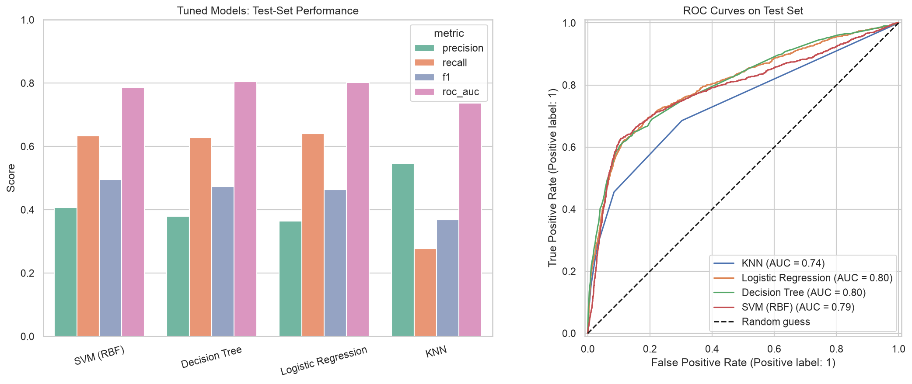
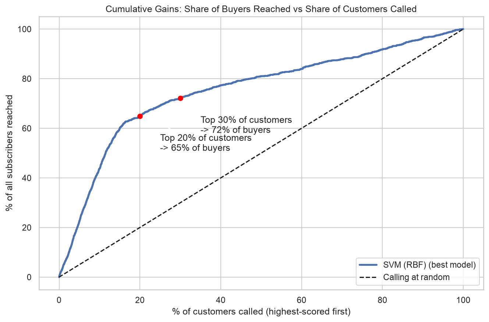

# Predicting Bank Term-Deposit Subscriptions: Comparing Classifiers

**Notebook:** [bank_marketing_classifier_comparison.ipynb](bank_marketing_classifier_comparison.ipynb)

Berkeley Haas ML/AI program, Module 17, Practical Application III.

## Business problem
A Portuguese bank phoned customers across 17 marketing campaigns (May 2008 to Nov 2010) to sell a term deposit. Only ~11% of calls succeed. The goal is to predict who will subscribe so agents can focus on the most promising customers. I compare **K-Nearest Neighbors, Logistic Regression, Decision Tree and SVM**.

## Data
UCI Bank Marketing dataset (`bank-additional-full.csv`, 41,188 rows, 20 inputs). Source: [UCI repository](https://archive.ics.uci.edu/ml/datasets/bank+marketing); paper in `data/CRISP-DM-BANK.pdf`.
- 12 duplicate rows removed; `pdays = 999` converted to a "previously contacted" flag.
- `duration` (call length) is **excluded** because it is only known after the call (data leakage).

## Method
- Stratified 75/25 train/test split; scaling and one-hot encoding inside pipelines so cross-validation does not leak.
- Metric: **F1 of the "yes" class** (primary, also the grid-search objective) and ROC-AUC. Accuracy is misleading because "always no" is already 88.7% accurate.
- 5-fold stratified cross-validation and `GridSearchCV` for every model (including class weighting).

## Results (held-out test set)
| Model | F1 | Recall | Precision | ROC-AUC |
|---|---|---|---|---|
| SVM (RBF) | **0.495** | 0.63 | 0.41 | 0.79 |
| Decision Tree | 0.473 | 0.63 | 0.38 | 0.80 |
| Logistic Regression | 0.464 | 0.64 | 0.36 | 0.80 |
| KNN | 0.369 | 0.28 | 0.55 | 0.74 |
| Baseline (always "no") | 0.000 | 0 | n/a | 0.50 |



## Summary of findings
- **Ranking customers by the model reaches about 65% of subscribers by calling only the top 20%** (random calling reaches 20%).
- **Who to call first:** customers who subscribed in a past campaign (65% success vs 9%), students (31%) and retirees (25%), and people reached on **cellular** phones (14.7% vs 5.2% on landlines).
- **When:** March and September to December convert at 44-51% but have low call volume; May has the most calls and the lowest success rate (6.4%). A pilot is needed to confirm timing effects.
- **Economy:** subscriptions cluster in low interest-rate periods.
- **Not useful:** housing and personal-loan status are not statistically related to subscribing.
- The top three models perform similarly; logistic regression or the decision tree are the practical choices because they are fast and explainable. Precision is only ~36-41%, so the model prioritizes calls but does not guarantee a sale.



## Recommendations / next steps
Prioritize call lists with the model, start with past successes and cellular contacts, pilot an A/B test, choose the cutoff using real call cost vs. deposit profit, retrain on recent data, and audit for fairness. See the notebook (sections 7 and 8) for details.

## Repository layout
```
├── README.md
├── bank_marketing_classifier_comparison.ipynb   # full analysis
├── requirements.txt
├── data/        # dataset, field descriptions, reference paper
└── images/      # figures exported from the notebook
```

## Reproduce
```bash
pip install -r requirements.txt
jupyter notebook bank_marketing_classifier_comparison.ipynb
```
